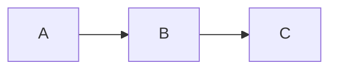

# Document Family Report

## Overview

This report covers **bold**, *italic*, ~~strike~~ and `inline code` plus a [link](https://example.com).

### Scope

The DOCX fixture keeps every construct the routed writer can express today. Math and image are covered by the blocked-path test instead.

## Lists

- first bullet
  - nested bullet
- second bullet with *emphasis*

1. one
2. two
3. three

## Table

| Name | Value | Note |
| --- | --- | --- |
| alpha | 1 | ok |
| beta | 2 | deferred |

## Code

```rust
fn main() { println!("hello"); }
```

## Diagram



## Chart

```vega-lite
{"$schema":"https://vega.github.io/schema/vega-lite/v5.json","data":{"values":[{"x":"A","y":3},{"x":"B","y":7}]},"mark":"bar","encoding":{"x":{"field":"x","type":"nominal"},"y":{"field":"y","type":"quantitative"}}}
```

## Footnote

A statement with a footnote.[^1]

[^1]: The footnote body.
